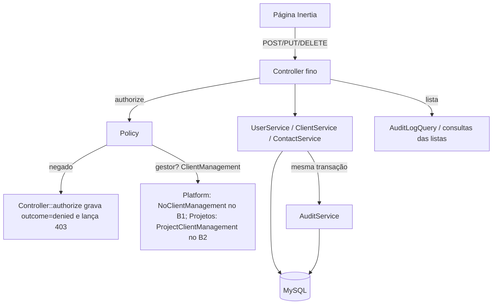

# B1 Núcleo Design

**Spec**: `.specs/features/b1-nucleo/spec.md`
**Status**: Approved (Cauã, 06/10/2026). Decisões do Lucas Scholz na review do PR #5 (07/10) aplicadas nas fases 12 e 13: ver "Decisões da review de 07/10" no fim.

---

## Architecture Overview

O caminho é o de todo o template: `FormRequest` (validação) → `authorize()` (Policy) → Service (regra, transação, auditoria) → `back()->with(...)`. Nada de migração: as seis tabelas do Núcleo vieram no B0. O que o B1 acrescenta é a camada de regra (Services e Policies), as telas e a gravação da negação.

Abordagens consideradas para o ponto que não é óbvio, a negação auditada (spec, Auditoria AC 2):

1. **Recomendada: `authorize()` do Controller base grava a negação.** Uma sobrescrita em `App\Http\Controllers\Controller` usa `Gate::inspect`; se nega, chama `AuditService::denied()` e lança o 403. Pega toda checagem de permissão real e nenhuma checagem só de exibição.
2. `Gate::after` global. Descartada: dispara também nos `can()` usados para montar a tela e encheria a auditoria de "negado" que ninguém tentou.
3. Gravar no `render` da exceção 403. Descartada: lá não se sabe qual registro nem qual ação.

---

## Code Reuse Analysis

### Existing Components to Leverage

| Component | Location | How to Use |
| --- | --- | --- |
| `Deactivatable` (`setActive`, `active()`, `deleteIfUnused`, `isReferenced`) | `app/Platform/Models/Concerns/Deactivatable.php` | Desativar, reativar e excluir só o nunca usado, nos três cadastros. A trava de linha já está lá |
| `AuditService::log` | `app/Platform/Services/AuditService.php` | Única gravação; ganha `denied()` e `scrubPersonalData()` |
| `TemporaryPasswordService` | `app/Platform/Services/TemporaryPasswordService.php` | Gera a senha provisória; separa gravar de enviar (falha de e-mail não desfaz o usuário) |
| `TemporaryPasswordMail` + views | `app/Mail`, `resources/views/mail` | Convite e reenvio; acrescenta a linha "Login: e-mail" (N1) |
| `SessionService::terminateOthers` | `app/Platform/Services/SessionService.php` | Derrubar todas as sessões ao desativar (sem sessão a manter) |
| `EnsureBackofficeUser` | `app/Http/Middleware` | Já recusa sessão de desativado; continua sendo o portão |
| `UserController` (lista, último admin, exclusão) | `app/Platform/Controllers/Admin/UserController.php` | A regra sai para o `UserService`; o controller fica fino |
| `UserFormDialog`, `DataTable`, `RowActions`, `ConfirmDialog`, `SearchInput`, `Pagination`, `EmptyState`, `StatusPill`, `FormField` | `resources/js/components` | Gabarito de CRUD (`stacks/ui.md` §4) nas quatro telas |
| `audit-logs/index.tsx` | `resources/js/pages/admin/audit-logs` | Base da tela de auditoria; ganha colunas, filtros e o detalhe com rótulos |
| `ClientFactory`, `UserFactory`, `WcjClientSeeder::CNPJ` | `database/` | Testes; a semente da WCJ já existe |
| `RotasAutorizadasTest` (A5), `ArquiteturaTest` (A4, A6, A7, A9) | `tests/Arch` | Portões que toda rota e Service novo precisam passar |

### Integration Points

| System | Integration Method |
| --- | --- |
| Projetos (`projects`, `project_members`) | Só pelo contrato `App\Platform\Contracts\ClientManagement`, ligado no `AppServiceProvider` (D1, ADR-001). No B1, a implementação vazia `App\Platform\Services\NoClientManagement`; o B2 entrega `Projetos\Services\ProjectClientManagement` e troca a ligação |
| Conexões de IA (`ai_authorizations`) | O `UserService` marca `revoked_at` nas ativas; o B8 passa a revogar o token do Passport no mesmo ponto |
| B2 (formulário do projeto) | Consome `ClientService::create` com a `ClientPolicy::create` do gestor e as listas de escolha (`UserService::choiceList`, `ClientService::choiceList`) |
| B3 (card de suporte) | Usa `Contact::active()` para "quem pediu"; a exclusão de contato já considera `tasks.requester_contact_id` pelo catálogo |

---

## Components

### Controller base: `authorize()` auditado

- **Purpose**: toda negação por Policy em controller vira linha `outcome = denied` (G3).
- **Location**: `app/Http/Controllers/Controller.php`; a checagem auditada mora no trait `app/Http/Concerns/AuditsDeniedAbilities.php`, que os FormRequests também usam por `AuthorizesBeforeValidation` para autorizar antes de validar (T37, A1 da review de 07/10)
- **Interfaces**: `authorize(string $ability, mixed $arguments = []): Response` (assinatura do `AuthorizesRequests`)
- **Dependencies**: `Gate::inspect`, `AuditService::denied`
- **Reuses**: o trait `AuthorizesRequests` do Laravel

### `AuditService`

- **Purpose**: a única porta de escrita em `audit_logs`.
- **Location**: `app/Platform/Services/AuditService.php`
- **Interfaces**:
  - `log(AuditActionEnum $action, Model $auditable, ?array $before, ?array $after, ?int $userId = null, ?int $aiAuthorizationId = null): AuditLog`
  - `denied(string $ability, Model|string $target): AuditLog`: `action` = a ação pretendida (`AuditActionEnum::forAbility`), `auditable_type` pelo morph map da classe, `auditable_id` nulo quando o alvo é a classe
  - `scrubPersonalData(Model $auditable, list<string> $fields): int`: apaga as chaves pessoais de `changes` nas linhas daquele registro (N12; a única escrita que altera linha existente)
- **Dependencies**: `AuditLog`, `request()->ip()` (dívida A4 já registrada)

### `AuditActionEnum`

- **Purpose**: o vocabulário de ações e o rótulo em português.
- **Location**: `app/Platform/Enums/AuditActionEnum.php`
- **Interfaces**: novos casos `DEACTIVATED`, `REACTIVATED`, `ANONYMIZED`, `VIEWED` (negação de leitura); `label()`; `static forAbility(string $ability): self` (`create`→`CREATED`, `update`→`UPDATED`, `delete`→`DELETED`, `deactivate`→`DEACTIVATED`, `reactivate`→`REACTIVATED`, `anonymize`→`ANONYMIZED`, `resendInvite`→`PASSWORD_RESET`, leitura→`VIEWED`)

### Regra `AlphanumericCnpj`

- **Purpose**: valida o CNPJ de 14 caracteres (12 alfanuméricos + 2 dígitos), com o dígito verificador da Receita: valor do caractere = código ASCII − 48, pesos do CNPJ numérico. Conferida com o exemplo oficial `12ABC34501DE35` e com o CNPJ da WCJ.
- **Location**: `app/Rules/AlphanumericCnpj.php`
- **Interfaces**: `validate()`; `static normalize(string): string` (tira máscara, maiúsculas)

### `ClientManagement` (contrato) e `NoClientManagement`

- **Purpose**: responder "o gestor X gere o cliente Y?" sem o Núcleo ler tabela de Projetos (A9). Desenho da revisão de 07/10 (ponto do Vitinho, aceito por Lucas Scholz), no padrão da ADR-001: contrato no Platform, implementação vazia no Platform, a real no módulo.
- **Location**: `app/Platform/Contracts/ClientManagement.php`; `app/Platform/Services/NoClientManagement.php`; `app/Platform/Services/MemoizedClientManagement.php`
- **Interfaces**: `manages(User $user, Client $client): bool`; `managedClientIds(User $user): list<int>`; `openProjectsCountByClient(list<int> $clientIds): array<int, int>` (para a confirmação de desativar, F1 §04; aprovado pelo Lucas Scholz na D7, em lote pelo A7 da review de 07/10)
- **Memória por requisição (T42, A7)**: o container entrega o `MemoizedClientManagement` (scoped, esquecido no fim de cada requisição), que fica na frente da implementação (`give()` no `AppServiceProvider`): `managedClientIds` sai uma vez por pessoa e responde também o `manages` das Policies; a lista de clientes pede os projetos abertos da página numa chamada só.
- **No B1**: a `NoClientManagement` responde `false`, `[]` e `0`. O gestor vê, cria e escolhe cliente, mas não edita cliente nem cria ou edita contato; a lista de contatos dele vem vazia; a confirmação de desativar sai sem a contagem. Os testes de gestor usam o dublê `tests/Support/ClientManagementFalso.php`.
- **No B2**: `Projetos\Services\ProjectClientManagement` (projeto com `manager_id` = gestor, ou gestor alocado em `project_members`, P1/P5; projetos sem `finished_at`) substitui a `NoClientManagement` no `give()` do `MemoizedClientManagement`.

### Policies

| Policy | Regras (F1 §09) |
| --- | --- |
| `UserPolicy` (alterada) | `viewAny`, `create`, `update`, `deactivate`, `reactivate`, `resendInvite`: admin. `delete`: admin e não a si mesmo. `viewChoiceList`: admin e gestor |
| `ClientPolicy` (nova) | `viewAny`, `view`, `create`: admin e gestor. `update`: admin, ou gestor que gere o cliente. `deactivate`: admin, nunca a WCJ. `reactivate`, `delete`: admin. `viewChoiceList`: admin e gestor |
| `ContactPolicy` (nova) | `viewAny`: admin e gestor (a lista do gestor é filtrada pelos clientes dele). `create(Client)`, `update`: admin, ou gestor que gere o cliente do contato. `deactivate`, `reactivate`, `delete`, `anonymize`: admin. Contato anonimizado: `update`, `reactivate`, `anonymize` negam |
| `AuditLogPolicy` (nova) | `viewAny`: admin. Substitui o gate `view-audit-logs` |

### Services

| Service | Métodos | Regras |
| --- | --- | --- |
| `UserService` | `invite`, `resendInvite`, `update`, `deactivate`, `reactivate`, `delete`, `choiceList` | N1–N4, N11, G2, IA4, IA6; último admin ativo; revoga `ai_authorizations` ativas ao trocar papel, a marca "IA pode escrever" ou desativar; e-mail enviado depois do commit, com falha registrada sem desfazer |
| `ClientService` | `create`, `update`, `deactivate`, `reactivate`, `delete`, `choiceList` | N5–N7, N11, G2; CNPJ sem máscara e maiúsculo; unique (país, documento) com mensagem que cita o cliente existente |
| `ContactService` | `create`, `update` (devolvem o aviso de e-mail repetido), `deactivate`, `reactivate`, `delete`, `anonymize` | N8, N9, N11, N12, G2; cliente precisa estar ativo; anonimizar numa transação; aviso de e-mail repetido com nome e cliente só para o Administrador (o resto recebe "Já existe um contato com este e-mail"); telefone gravado como texto, busca pelos dígitos (`REGEXP_REPLACE` com o termo como parâmetro) |
| `AuditLogQuery` | `paginate(array $filters)`, `describe(AuditLog)` | Filtros do F1 §05; "Registro" legível; canal pelo assistente |

### Controllers e rotas

Caminhos em inglês e rótulos em português (`stacks/laravel-inertia.md` §6; D2).

| Rota | Ação |
| --- | --- |
| `GET/POST /admin/users`, `PUT/DELETE /admin/users/{user}` | lista, convidar, editar, excluir |
| `POST /admin/users/{user}/reset-password` | *Reenviar convite* (mesma rota do template, D4) |
| `POST /admin/users/{user}/deactivate`, `/reactivate` | desativar, reativar |
| `GET/POST /admin/clients`, `GET/PUT/DELETE /admin/clients/{client}` | lista, criar, ficha com contatos, editar, excluir |
| `POST /admin/clients/{client}/deactivate`, `/reactivate` | desativar, reativar |
| `GET /admin/contacts`, `POST /admin/clients/{client}/contacts`, `PUT/DELETE /admin/contacts/{contact}` | lista geral, criar no cliente, editar, excluir |
| `POST /admin/contacts/{contact}/deactivate`, `/reactivate`, `/anonymize` | desativar, reativar, anonimizar |
| `GET /admin/audit-logs` | lista, filtros e `?type=&id=` do *Histórico* |

### Telas

| Página | O que muda |
| --- | --- |
| `pages/admin/users/index.tsx` | Colunas do F1 §03 (Último acesso, Situação); filtro *Mostrar desativados*; ações *Reenviar convite*, Editar, Desativar/Reativar, Excluir, *Histórico*; o formulário ganha "IA pode escrever" e perde a caixa "ativo" (D3) |
| `pages/admin/clients/index.tsx` + `components/clients/client-form-dialog.tsx` | Gabarito; rótulo CNPJ ↔ Identificador fiscal pelo país |
| `pages/admin/clients/show.tsx` | Ficha com Dados e a aba Contatos (escopo B1; ADR-004) |
| `pages/admin/contacts/index.tsx` + `components/contacts/contact-form-dialog.tsx` + `anonymize-contact-dialog.tsx` | Lista geral e diálogo que exige digitar ANONIMIZAR |
| `pages/admin/audit-logs/index.tsx` | Colunas, filtros, detalhe antes/depois com rótulos dos campos, negado em destaque |
| `components/app-sidebar.tsx` | Grupo "Administração": Usuários, Clientes, Contatos, Auditoria, por ability |

---

## Data Models

Nenhuma tabela nem coluna nova. Os Models existentes ganham:

- `Contact`: `factory` (`ContactFactory`), `isAnonymized()` (existe linha `anonymized` na auditoria do contato; D5) e o escopo `notAnonymized`.
- `Client`: `isWcj()` (documento `38614817000122` no `BR`).
- `User`: escopo da coluna "Último acesso" por subconsulta em `audit_logs` (`action = login`).
- `AuditLog`: rótulos de campo para o detalhe (`name` → Nome, `role_id` → Papel…), na camada de exibição.

---

## Error Handling Strategy

| Error Scenario | Handling | User Impact |
| --- | --- | --- |
| Policy nega | `authorize()` grava `denied` e lança 403; nos FormRequests, antes da validação (`AuthorizesBeforeValidation`, A1 da review) | Página 403 do template, sem erro de validação que revele dado; a tentativa aparece na auditoria |
| CNPJ repetido no país | `ValidationException` no Service, com o nome do cliente existente | "Já existe o cliente X com este CNPJ" no campo |
| E-mail de convite falha | Usuário fica; `Log::error`; flash de erro | "Usuário criado; o e-mail não pôde ser enviado. Use Reenviar convite." |
| Excluir registro já usado | `deleteIfUnused` devolve false; `DomainException` vira flash de erro pelo `attempt()` do Controller base, nada muda (D6 da review: toast, não 403) | "<X> já usado: desative em vez de excluir" |
| Trocar CNPJ ou país da WCJ | `ClientService::update` lança `DomainException` (N7; A2 da review) | "O CNPJ e o país da WCJ não podem ser alterados" |
| Último admin ativo | Service recusa antes de gravar | Mensagem do template |
| Anonimização falha no meio | Transação desfaz | Toast de erro; contato como estava |
| Confirmação diferente de ANONIMIZAR | Erro de validação no FormRequest | Mensagem no campo |
| Convite simultâneo do mesmo e-mail | Unique do banco; `QueryException` 1062 vira erro de validação | "Este e-mail já está em uso" |

---

## Risks & Concerns

| Concern | Location (file:line) | Impact | Mitigation |
| --- | --- | --- | --- |
| Auditoria gravada fora da transação da escrita | `app/Platform/Controllers/Admin/UserController.php:96` | Usuário criado sem linha de auditoria se o log falhar | Services gravam a escrita e o log no mesmo `DB::transaction` |
| E-mail enviado dentro da gravação da senha | `app/Platform/Services/TemporaryPasswordService.php:30` | Falha de SMTP desfaria o usuário, ou o e-mail sairia antes do commit | Separar `issue` (grava) de `send` (envia depois do commit) |
| Núcleo precisa saber os clientes do gestor, mas A9 proíbe ler `projects` | `tests/Arch/ArquiteturaTest.php:123` | Policy do gestor não teria como decidir | Contrato `ClientManagement` com a implementação vazia no B1 e a real no B2 (D1, ADR-001). Até o B2, gestor não edita cliente nem contato |
| Controllers da dívida A6 (UserController 201 linhas, AuditLogController::index 43) | `tests/Arch/divida.php` | Crescer o controller quebra o teto | A regra sai para Services e `AuditLogQuery`; a dívida diminui e sai do `divida.php` |
| `e2e:serve` fixa a porta 8000, a mesma do `composer dev` | `package.json` (script `e2e:serve`) | E2E e servidor de desenvolvimento colidem | Na verificação, servir o e2e em outra porta com `E2E_BASE_URL` |
| `ClientFactory` gera documento numérico aleatório, quase nunca um CNPJ válido | `database/factories/ClientFactory.php:25` | Teste que passa pelo Service com documento da factory falha | Factory passa a gerar CNPJ válido (dígito calculado) |

---

## Tech Decisions

| Decision | Choice | Rationale |
| --- | --- | --- |
| D1 Clientes do gestor | Contrato `ClientManagement` no Platform; implementação vazia `NoClientManagement` no B1, ligada no `AppServiceProvider`; a real (`ProjectClientManagement`) é do B2 | Revisão de 07/10 (Vitinho, aceita por Lucas Scholz): o Platform não lê `projects` (A9) e o B1 não entrega código de Projetos. Padrão registrado na ADR-001; a ADR-003 e o AD-003 do desenho anterior saíram |
| D2 Caminhos das rotas | Inglês (`/admin/clients`), como o template | `stacks/laravel-inertia.md` §6; aprovado por Lucas Scholz em 07/10 (D4 da review), e o `escopo.md` B1 passou a citar os caminhos em inglês |
| D3 Desativar | Ação própria na linha, com a confirmação do F1 §04, em vez da caixa "ativo" no formulário | O funcional manda na tela e pede confirmação com texto próprio ("Fulano perde o acesso imediatamente"); a auditoria registra `deactivated`/`reactivated`, como a spec pede |
| D4 Reenviar convite | A rota `reset-password` do template, renomeada na tela | Premissa confirmada na spec |
| D5 Situação "Anonimizado" | Derivada da linha `anonymized` na auditoria; o contato anonimizado também é desativado | Sem coluna nova (`banco.txt`); desativar tira o contato das listas de escolha |
| D6 Listas de escolha (P2) | Métodos de Service + `viewChoiceList` nas Policies, sem rota JSON | "Sem fetch direto: tudo via Inertia"; o B2 entrega as listas como props da página dele |
| D7 Ficha do cliente | Página `clients/show.tsx` | O escopo B1 lista `/admin/clientes/{id}` com a aba de contatos; `stacks/ui.md` pede ADR para página de ficha: ADR-004 |

### Decisões da review de 07/10 (Lucas Scholz, PR #5)

| # | Decisão | Onde ficou |
| --- | --- | --- |
| D1 | Gestor cria cliente também em Administração → Clientes | Código sem mudança; F1 §04 e §09, `escopo.md` B1 |
| D2 | Aviso de e-mail repetido: nome e cliente só para o Administrador | `ContactService::duplicateWarning`; spec Contatos AC 3; F1 §02 e §07 |
| D3 | Telefone é texto, até 20, gravado como digitado; busca pelos dígitos | `StoreContactRequest` sem `normalizeDigits`; `ContactService`; tela sem máscara; spec e F1 §02 |
| D4 | Caminhos em inglês | D2 acima; `escopo.md` B1 |
| D5 | Abilities `view_clients`, `view_contacts`, `view_audit_logs`; `delete_records` e `reset_passwords` seguem `isAdmin()` | Código sem mudança; `escopo.md` §4 |
| D6 | Excluir o já usado: toast de erro, não 403 | Spec Usuários AC 12, Clientes AC 12, Contatos AC 9; sem `SPEC_DEVIATION` no código |
| D7 | `openProjectsCount` aprovado (em lote: `openProjectsCountByClient`, A7); textos N = 0 e N = 1 | Contrato `ClientManagement`; spec Clientes AC 9; F1 §04 |
| D8 | Aviso de e-mail só entre contatos ativos | Sem mudança |
| D9 | Carga diária sem passo de 0,25 | `user-form-dialog.tsx` com `step="any"` |
| D10 | Lista geral de contatos vazia com "Ir para Clientes" até o B2 | Sem mudança |
| D11 | Contato excluído deixa dado pessoal na linha `deleted` da auditoria | Limitação registrada na `necessidade.md` (N12) |
